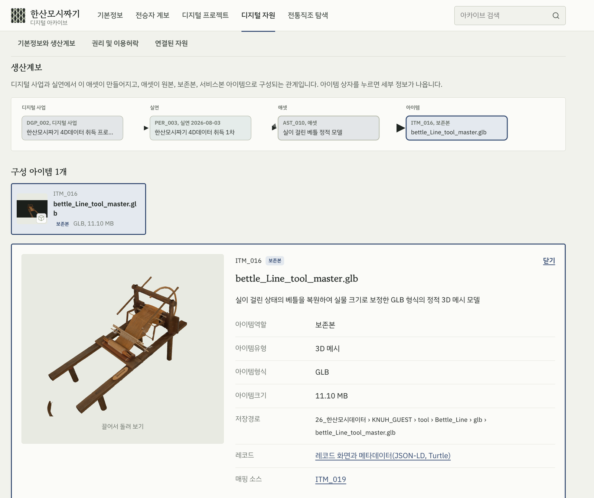
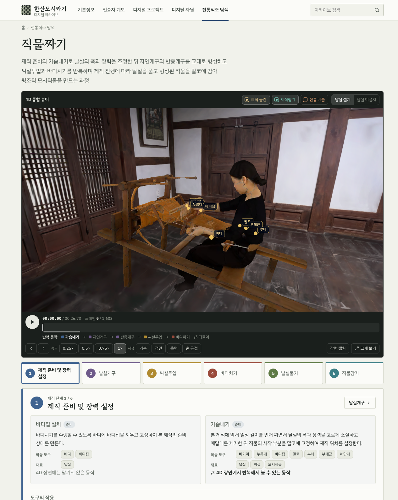
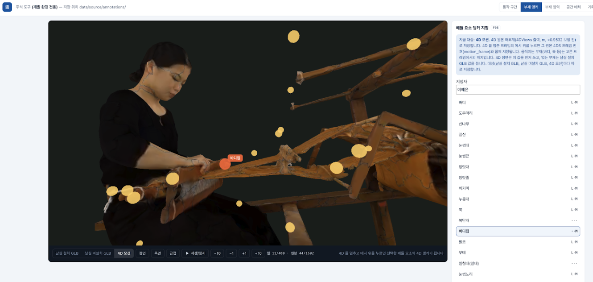
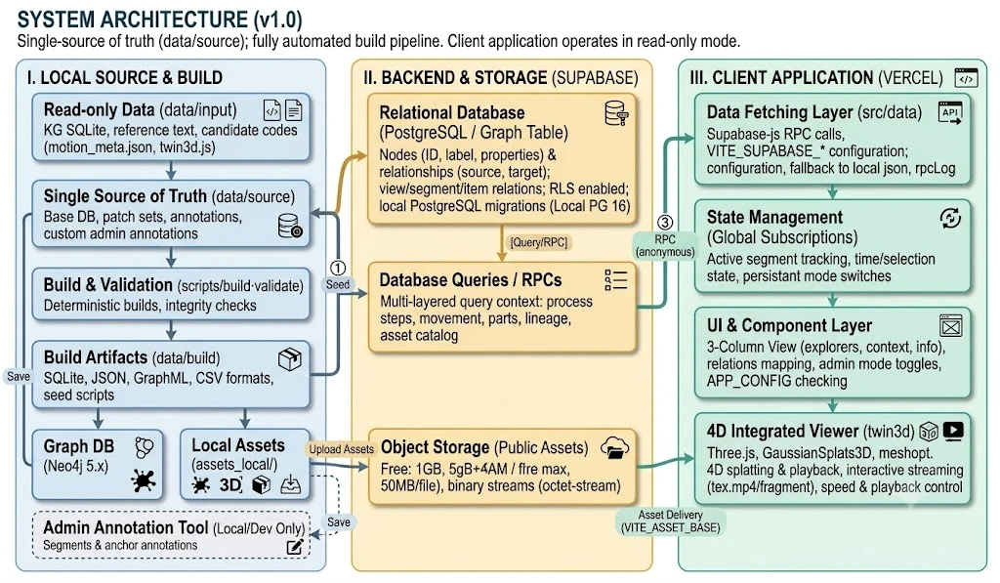

# 01 Hansan Mosi Weaving: A Scene-Centred 4D Archive of Intangible Cultural Heritage

[Explore the digital archive](https://hansan-mosi-archive.vercel.app/) , Desktop Chrome recommended for the approximately 100 MB integrated 4D scene. The interface is in Korean; the captions below describe each view.

## Research overview

The digital documentation of intangible cultural heritage presents a challenge that extends beyond the accurate reproduction of individual objects or performances. Traditional craftsmanship is constituted through coordinated bodily actions, material transformations, specialised tools, and the knowledge transmitted among practitioners. When these components are documented independently, their relationships can become difficult to reconstruct, evaluate, and interpret within a scholarly environment.

This project investigates a scene-centred approach to the digital documentation and interpretation of Hansan Mosi weaving, the traditional production of fine ramie fabric inscribed on UNESCO's Representative List of the Intangible Cultural Heritage of Humanity in 2011. Rather than treating volumetric recordings, reconstructed environments, and collection metadata as separate resources, the archive brings them into an integrated interpretative environment. A semantic knowledge graph establishes explicit relationships between the recorded weaving activity, its material and technical context, the people associated with its transmission, and the provenance of the resulting digital assets.

Developed as a research prototype within a master's thesis on semantic modelling for intangible heritage, the archive examines how spatially and temporally situated annotations can make multidimensional records accessible as contextualised research evidence.

## Integrated 3D/4D documentation

The archive brings together three complementary representations of the weaving practice. A spatial reconstruction situates the activity within its documented setting, a volumetric recording preserves the temporal development of the performance, and detailed loom models support the identification of components involved in specific actions. Their integration enables the relationships between practitioner, tool, and material to be explored within a shared scene rather than inferred from independent media files.

| Representation | Documentation source | Web-delivery format |
|---|---|---|
| Weaving environment | 3D Gaussian Splatting reconstruction of the weaving hall at the Hansan Mosi Transmission Centre | `.splat`, 37.8 MB |
| Weaving performance | Volumetric capture of a weaving demonstration: 1,603 source frames recorded at 60 fps (approximately 27 seconds) | 401-frame, 15 fps web sequence of mesh segments and texture video |
| Traditional loom | Two 3D representations of the loom, with and without warp threads | glTF (`.glb`), approximately 10–12 MB each |

The volumetric performance and loom models originate from a common calibration session. Their spatial integration nevertheless requires explicit treatment of differences in scale and file-level transformations. A correction factor of 0.9532 is therefore applied to the volumetric representation alone, as the corresponding adjustment is already incorporated into the loom models. Retaining this calibration decision as paradata helps distinguish the source documentation from subsequent processing and presentation choices.

## Semantic modelling and digital provenance

The semantic model treats the weaving scene as an interpretative point of entry into relationships that cannot be expressed adequately through geometry alone. Processes and movements are associated with the tools and materials on which they act, while practitioners and documentation projects provide the social and institutional context of the digital records. The same model distinguishes the production of a resource from its subsequent representation as an asset and as individual files, supporting traceability across the digitisation lifecycle.

The current knowledge graph (v4.3) contains 705 records in 15 classes, with 2,216 relations and 56 defined relation patterns. Each relation records whether it originates in the source data or is derived through an inverse or path-based transformation. Within the interface, this structure supports navigation from a digitisation project to its documented performance, the assets produced from it, and their individual items, together with the applicable rights and licence. For the volumetric weaving sequence, for example, six rights held by two parties and one public licence are retrievable from the asset record.

The item-level view is intended to make the evidential context of a digital object inspectable. Each asset is resolved into items with distinct roles (original, preservation copy, and service copy for web delivery), so the file seen in the browser can be traced to the master it was derived from. A reconstructed loom can thus be examined not only as a glTF model but also as a resource whose production history, technical characteristics, and connections to the recorded weaving practice are explicitly described, with a link to its record in JSON-LD and Turtle.

## Temporal interpretation of weaving processes

Interpreting the recorded performance requires a connection between continuous 4D data and the analytical units used to describe traditional weaving. The interface organises the weaving activity into six stages and eight identified movements. Movements are related to the loom components they operate and the materials they act on, allowing a stage of production to be examined through the interaction between the practitioner's actions and the physical equipment.

The integrated viewer combines the reconstructed environment, volumetric performance, and loom representations in a common navigational context. The relationship between movement segments and tools provides a basis for examining how material processes unfold over time, while retaining links to their descriptions in the underlying data model. Temporal references are stored against the original 60 fps recording and converted when needed for the 15 fps web derivative, so the interpretative annotation remains associated with its source recording rather than with a particular delivery format.

## Spatial annotation and interpretative paradata

Spatial annotation associates named loom components with positions or regions in the three-dimensional scene. The research prototype includes an in-browser annotation environment in which anchors are placed and reviewed against the displayed 3D/4D representation. The annotation set comprises 30 anchors: the 22 loom elements operated by the eight weaving movements, and eight further structural elements of the loom. Because several elements move during weaving, their anchors are keyed to frames of the volumetric recording rather than fixed in space: the reed and the batten carry 28 keyframes each and the shuttle 36, set at intervals of 40–80 source frames, so that each label follows its part as the performance plays.

The annotation process also raises questions about the status of the recorded information. Spatial coordinates, temporal boundaries, and component identification depend on interpretative decisions that may require later confirmation. Annotations are therefore treated as research assertions rather than automatically verified properties of the source record. Unconfirmed values retain an explicit `verification_status`, which the application can expose through its verification view (`?verify=1`). Information that has not been established is not replaced by inferred values solely to produce a complete-looking interface.

This distinction between source evidence, annotation, and interpretation is central to the archive's approach to paradata. It provides a basis for documenting how an interpretation was constructed and for revising that interpretation without obscuring the original digital record.

## Data validation and FAIR-oriented publication

The semantic model is evaluated through competency questions addressing the consistency and retrievability of its intended relationships. The [validation report](data-model/cq_validation_report.md) (in Korean) examines referential integrity, the ordering of production processes, movement–tool–material relationships, the provenance of digitised resources, and their associated rights information. Eight checks pass, one of them with two optional relation patterns that have no instances yet. The remaining temporal-linkage question (CQ6) is marked partial in this validation snapshot because time-indexed movement segments had not yet been materialised as timed relations. This separates the availability of an annotation workflow from verified coverage of the resulting temporal data.

The publication workflow generates machine-readable records in JSON-LD and RDF/Turtle and validates their structure against [SHACL shapes](data-model/shapes.ttl). The [export report](data-model/validation_report.md) (in Korean) records conformance for 27,602 record triples, with no SHACL violations and identical JSON-LD and Turtle round trips. Further measures include SHA-256 fixity checks, record version and status information, licence identifiers with ODRL policy descriptions, and a [DCAT catalogue](data-model/catalog.ttl) describing the published distributions. Representative records describe a [4D item](data-model/sample-records/ITM_008.ttl), its [digital asset](data-model/sample-records/AST_005.ttl), a [weaving movement](data-model/sample-records/MOV_040.ttl), a [loom component](data-model/sample-records/TOL_012.ttl), and a [production process](data-model/sample-records/PRC_010.ttl).

At the deployed address, each record resolves through content negotiation: [`/id/ITM_016`](https://hansan-mosi-archive.vercel.app/id/ITM_016) returns the record page in a browser, and JSON-LD or Turtle when requested with the corresponding `Accept` header. Identifiers follow a defined URI pattern (`https://w3id.org/hansan-mosi/id/{ID}`) with deterministic UUID v5 values, and deleted records are retained as tombstones to preserve the history of the dataset. These mechanisms form part of a FAIR-oriented publication strategy rather than evidence that all FAIR requirements have been satisfied. In particular, registration of the `w3id.org/hansan-mosi` namespace, which would make the persistent URIs resolve to these records, remains outstanding. An indicator-level assessment of implemented measures and remaining requirements is available in the [FAIR maturity assessment](../07_fair-assessment/).

## System architecture and evaluation

The system separates the authoritative research data and build procedures from database services and the public-facing application. Source records, curated patches and annotations are kept in one editable location; a deterministic build produces every published form, validates it, and loads it into the database. PostgreSQL and storage services provided through Supabase support structured resource queries and delivery of digital assets, while the deployed client presents the resulting information through a web interface developed with Vite, TypeScript, and Three.js, with Gaussian-splat and volumetric viewing components for the 4D scene. Thirteen database query functions, one per information need, are accompanied by a static-JSON implementation of the same queries, and a parity test confirms identical results across the two delivery modes.

The application additionally includes instrumentation for task-based usability evaluation. The proposed procedure comprises three information-exploration tasks and the System Usability Scale (SUS); the evaluation mode records interface navigation, selection events, and task durations locally without requiring personal identifiers. This constitutes an implemented evaluation mechanism, not a claim that a completed user study or its results are reported in the repository.

## Contribution and scope

The project demonstrates how the documentation of a traditional craft can be organised around relationships between recorded performance, material practice, digital provenance, and scholarly interpretation. Its principal research contribution lies in the design and implementation of a scene-centred semantic framework through which spatial and temporal annotations can be connected to traceable cultural-heritage records, rather than treated as isolated labels attached to 3D media.

The research responsibilities represented in this portfolio include semantic-model design, knowledge-graph development, interface and annotation-tool design, integration of the 3D/4D viewer, FAIR-oriented export and validation, and the preparation of a user-evaluation framework. The original 3D and 4D documentation was produced through a separate capture project and is not presented as independent work by the portfolio author. Project-specific responsibilities and collaborators are recorded in [CONTRIBUTIONS.md](../CONTRIBUTIONS.md).
