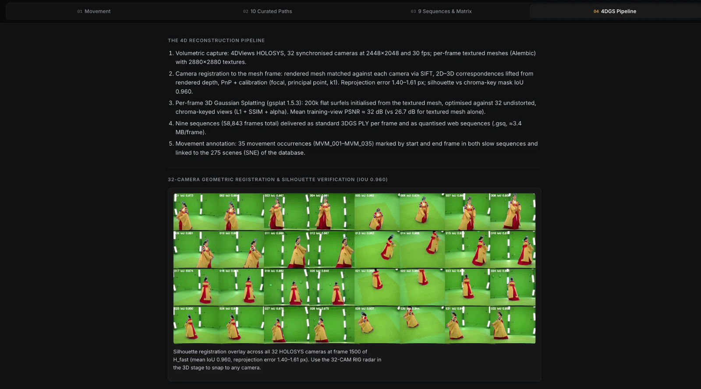
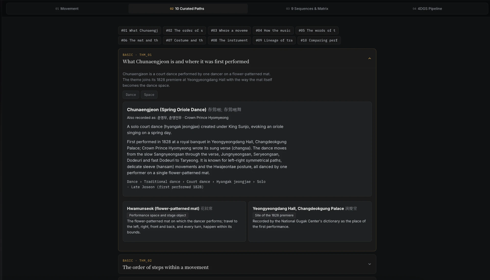

# 02 From Volumetric Capture to an Interpretation Platform for ICH

[Open the interpretation platform](https://chunaengjeon-4d.vercel.app/), desktop Chrome recommended. Platform source in [`platform/`](platform/), reconstruction code in [`pipeline/`](pipeline/).

## Research overview

*Chunaengjeon* (春鶯囀, "Spring Oriole Song") is a solo court dance first performed in 1828, danced by one performer on a single flower-patterned mat. Its knowledge is carried by a sequence of named movements, the court music that accompanies them, a sung verse, costume and props, and a line of transmission. Volumetric capture records the dancer's body precisely but none of this meaning; a database of the choreography holds the meaning but no body. This project connects the two. The performance was captured volumetrically, every frame was rebuilt as 3D Gaussian Splatting (3DGS), and the resulting 4D record is linked, frame range by frame range, to a scene-centred database of the dance.

## Capture and reconstruction

| Step | Method | Result |
|---|---|---|
| Capture | 4DViews HOLOSYS, 32 cameras at 2448 × 2048 and 30 fps; per-frame textured meshes (Alembic, 2880 × 2880 textures); photogrammetry and motion capture of the same dancer | Nine sequences (slow and fast tempo in court costume, practice clothes and a marker suit, plus calibration poses); about 844 GB raw |
| Camera registration | The capture export contains no cameras. The textured mesh was rendered, matched to each camera image with SIFT, lifted to 3D with the rendered depth, and solved by PnP with focal length, principal point and k1 ([`calibrate.py`](pipeline/calibrate.py)) | Reprojection error 1.40–1.61 px; silhouette IoU 0.960 against the chroma-key mask; consistent with an independent COLMAP calibration and shared by all sequences |
| Per-frame 3DGS | 200k flat Gaussians initialised from the textured mesh and optimised against 32 undistorted, chroma-keyed views (L1 + SSIM + alpha, gsplat 1.5.3; [`train_frames.py`](pipeline/train_frames.py)) | Mean training-view PSNR ≈ 32 dB, against 26.7 dB for the textured mesh alone |
| Delivery | Standard 3DGS PLY per frame and a quantised web sequence (`.gsq`, ≈ 3.4 MB per frame; [`pack_sequence.py`](pipeline/pack_sequence.py)) | 58,843 frames over nine sequences, archived as PLY and web packages |

Camera parameters are published in [`pipeline/calib/`](pipeline/calib/) (OpenCV convention). The platform reuses them, so the reconstruction can be viewed from any of the 32 capture positions.

## A scene-centred database of the dance

The dance is modelled as a document database with one collection per class ([specification v12](data-model/metadata-specification-v12.md), 14 collections). **Scene** is the hub, linking a movement to its music, verse, space, performer and source of transmission. For Chunaengjeon the database holds 275 scenes, 35 movement occurrences of 27 named movements, six accompaniment pieces with their tempi and rhythmic cycles, 20 instruments, the four-line verse with translation and commentary, two spaces, two costumes, the capture session and four transmitters. Scene descriptions follow the National Gugak Center's court-dance notation (1987).

The bridge to the 4D record is a **movement annotation**: the start and end frames of all 35 movements in each slow sequence, tied to the scene range they cover. Because the same choreography was recorded in court costume (15,490 frames) and in practice clothes (15,970 frames), every movement can be located and compared in both.

## The interpretation platform

The platform combines a WebGL2 player that decodes the 3DGS frames in the browser, an interpretation panel and a synchronised timeline, in three layouts (Split Studio, Cinema 4D and Editorial Dossier).

- **4D stage.** Free orbit, front, side and top views; the 32-camera rig for snapping to any capture position; the outline of the mat; and an option to open a local `.gsq` folder for full-length sequences.
- **Movement.** Name in Korean, hanja and romanisation with an English gloss; definition; linked entities such as the mat, the sleeves and the transmitter; the spatial path on the mat; frame ranges and durations in both recordings, with approximate ranges for the scenes within them; recurrence, music, verse, step-by-step scenes and sources.
- **Ten curated paths.** Interpretive routes from the database's interpretation design, from the dance's 1828 premiere to music and movement, verse and gesture, costume and sleeves, lineage, and the comparison of the two recordings.
- **Sequences and pipeline.** All nine capture sequences, and the reconstruction steps with their registration evidence, inside the interface.
- **Paradata in view.** Open questions recorded in the database (a spelling awaiting expert review, details still to be checked against the capture) are flagged rather than smoothed over, and the interpretation source (notation and lineage) is kept apart from the performance source (the capture). Search covers movements, paths and cameras, in English and Korean.

The web edition bundles a 10-second excerpt (150 frames), because the full slow sequences are 49–51 GB each. Movement-level excerpts can be added with [`export_movement_clips.py`](platform/tools/export_movement_clips.py), and the database is rebuilt from the workbook and annotations with [`build_data.py`](platform/tools/build_data.py).

## Contribution and scope

The project shows how a volumetric record can be published as a citable source: addressable by frame range, linked to named units of choreography and to the sources of their interpretation, and comparable across performances. The same structure underlies ongoing research on comparing movement across costumes and recordings, and connects to the semantic model of the IHCI 2026 paper *From Movement to Scene*.

The work presented here covers the reconstruction pipeline (camera registration, per-frame training, packing and players), the scene database and its interpretive paths, the movement annotation, and the platform. The capture was carried out within a collaborative project; the partner institutions and their roles are recorded in [CONTRIBUTIONS.md](../CONTRIBUTIONS.md).
