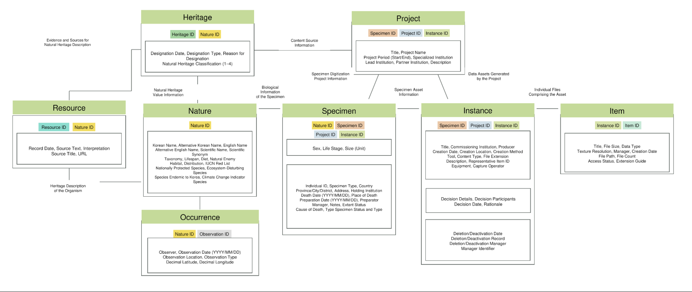

# 03 NEXUS: User-Adaptive Knowledge-Graph Exploration of Digital Natural Heritage

[Open the NEXUS platform](https://natural-extended-specimen.netlify.app/), published in *Applied Sciences* 16(19), 9955 (2026), [doi:10.3390/app16199955](https://doi.org/10.3390/app16199955). The reproducibility package is in [`reproducibility/`](reproducibility/).

## Research overview

Natural heritage is relational. A species becomes heritage through its specimens and observations, its designation as a protected monument, the historical and folk sources that record it, and the digital resources made from it. Natural history digitisation has nonetheless concentrated on access to specimens and the sharing of data, and many collection systems still store 3D models as attachments whose production and reuse are hard to trace. The resulting records are fragmented, and they rarely reflect why a user is exploring them.

NEXUS (Natural Heritage EXploration through User-adaptive Semantics) addresses this in three steps: a natural-heritage data model and database centred on 3D specimens; user requirements elicited from experts and modelled as user context; and a knowledge graph that joins the two and drives a user-adaptive interface whose recommendations remain inspectable. The case study is the crane family (Gruidae), whose Korean species are designated Natural Monuments. The study asks:

- **RQ1.** How can user requirements be semantically modelled for natural heritage?
- **RQ2.** How can interpretable, user-specific exploration paths be inferred from human–natural heritage relations?
- **RQ3.** How does an interface built on these priorities support users' contextual understanding?

## A 3D-centred natural-heritage data model and database

The Natural Historical Specimen (NHS) data model separates biological description, physical specimen management, digitisation provenance and use context. **Nature** holds taxonomic and ecological assertions, **Occurrence** the evidence of an organism at a place and time, and **Specimen** the curated physical object. **Project** groups records from one initiative; **Instance** models digitisation as an event, with its actors, methods, equipment, software and decisions; and **Item** identifies the resulting files. **Heritage** records designations and their rationale, and **Resource** the documentary sources. Because the layers are connected through stable identifiers rather than merged, a file conversion or a revised identification does not overwrite evidence in another layer. Crosswalks align the model with Darwin Core, PROV-O and MorphoSource practice, and CIDOC CRM.



The operational database (*Digital Museum Nature AI DB*) holds 3,685 records from seven South Korean institutions, across seven tables and 123 fields. Of 919 Nature records, 473 link to at least one of 643 specimens. The 641 Instance records keep photogrammetric production events separate from 532 Item records, most of them GLB files, so provenance remains stable when the publication or access status of a file changes. Project is realised through shared identifiers rather than a table of its own. The model runs in a prototype collection management system and the public AI Nature Platform.

## From expert requirements to user context

Four experts were interviewed in depth, with 7–15 years of practice in forest ecology research, biological exhibitions, natural-heritage policy, and folk natural-heritage education. A Kano–QFD analysis turned 13 requirements in four themes (provenance and reliability, context-dependent granularity, relational and temporal exploration, reusability and interoperability) into 11 design attributes with priorities. Relation and path ranking received the highest priority (1.000), followed by 3D analysis (0.800) and provenance and evidence (0.675).

The service had been scoped for **semi-experts**: users between specialists and the general public. The interviews questioned that premise. One expert argued for adjacent expertise such as palaeontology and content production, and needs varied with task and expertise rather than with occupation. The target user was therefore modelled as a composition rather than a fixed type. The **User Context Ontology (UCO)** describes an exploration through KnowledgeProfile (expertise level and domain familiarity), PurposeProfile, PreferenceProfile and ExplorationBehavior. Six cold-start questions turn these into weights over four exploration profiles: research and analysis, content creation, citizen participation and heritage interpretation.

## Knowledge graph and interpretable adaptive ranking

The **Natural Heritage Ontology (NHO)** implements the data model in Neo4j in three layers: biodiversity (Nature, Specimen, Observation), heritage (Heritage, Resource) and digitisation (Project, Instance, Item). It was populated from GBIF occurrences, designation and interpretation resources published by Korean public agencies, and 3D captures of collection specimens with their paradata. The crane graph holds 2,910 nodes and 3,251 relations; semantic validation found four erroneous designation links, which were excluded from the analyses.

Ranking couples the UCO and the NHO at a single point, a profile–relation affinity matrix. The user's profile weights become weights for eight relation types, and candidates within three hops of a focal record are scored by relation compatibility along the best path, proximity, and a design prior derived from the QFD priorities, with coefficients (0.55, 0.25, 0.20). All affinities are positive, so context changes priority without hiding any relation. Because the score is a sum of these three terms, each recommendation is shown with its path, its dominant relation and its exact score composition as **graph evidence**.

## User-adaptive interface

A cold start elicits the user's context and shows the resulting profile. Recommendations follow with their graph evidence, and a detailed view is organised in four areas: 3D assets, specimen and biological information, observation and spatial information, and heritage context. The 3D area uses the **Smithsonian Voyager** web viewer for rotation, zoom, material switching and distance measurement. The specimen area compares holdings across institutions, the observation area relates observation sites to natural-heritage locations, and the heritage area presents designation value and habitat change as a narrative. Profiles decide only which area opens first and the order of functions; every area stays accessible.

In the 3D asset area, the original GLB linked to a specimen is loaded directly into Voyager Explorer, embedded in the page. Beside the viewer, a digitisation paradata panel follows the data model from the specimen to its digitisation Instance and Item, and gives the file name, size and model composition. The Voyager tools, distance measurement, view reset and full screen sit next to downloads of the GLB and of the node and edge tables of the specimen's graph.


## Evaluation

| Component | Design | Main finding |
|---|---|---|
| Semantic validation | Seven competency questions on the red-crowned crane (*Grus japonensis*), with negative controls | The corrected focal structure retrieves four specimens, one observation, 23 documentary resources and two designations; four erroneous designation links were identified and excluded |
| Adaptive inference | 12 focal records × 4 profiles | Profiles reorder the same result sets (Overlap@5 0.303, Overlap@10 0.625, Kendall's τ 0.180). Uniform affinities remove the differences, and rankings stay stable under ±20 % affinity changes (Overlap@10 0.978, τ 0.951) |
| Formative user evaluation | 20 participants, adaptive vs. static interface | High ratings in both conditions (median 4.43 vs. 4.33) with no significant difference; participants described newly recognised ecological and heritage connections |

The [reproducibility package](reproducibility/) re-runs the corrected competency questions, including negative controls, and the ranking analyses with Python and Node standard libraries only, without a database. Its checksums and results were re-verified for this portfolio.

```sh
cd reproducibility
python3 validate_cq_subset.py   # competency questions CQ1–CQ7 and negative controls NC1–NC3
node reproduce_ranking.cjs      # ranking analyses; writes results_reproduced.json
```

## Contribution and scope

NEXUS makes the path from expressed requirements to system features traceable, and shows that context-sensitive prioritisation over a shared natural-heritage graph can be executed and inspected. It treats 3D specimens as managed derivatives within biological and curatorial histories rather than as attachments. The scope is bounded: the affinities are researcher-specified design parameters, the graph does not yet distinguish taxon-specific from broader documentary associations, and the user study is small, covers a single case, and does not establish an advantage for adaptive presentation. Ranking relevance remains to be assessed against independent judgements.

Outputs:
- *NEXUS: Interpretable Knowledge-Graph Recommendation for User-Adaptive Exploration of Digital Natural Heritage*, Applied Sciences 16(19), 9955 (2026), first author
- *Semantic Collaborative Environment for Extended Digital Natural Heritage: Integrating Data, Metadata, and Paradata*, Heritage 8(12), 507 (2025), first author, [doi:10.3390/heritage8120507](https://doi.org/10.3390/heritage8120507)
- TDWG 2026 presentation on the 3D-centred natural-heritage data model

The work presented here covers the data model and database design, the requirements analysis, the NHO and UCO, the ranking model and its evaluation, and the reproducibility package. The 3D specimens are used in the map-based narratives of [NHIV](../04_nhiv-3d-specimen-maps/). Project-specific responsibilities are recorded in [CONTRIBUTIONS.md](../CONTRIBUTIONS.md).
