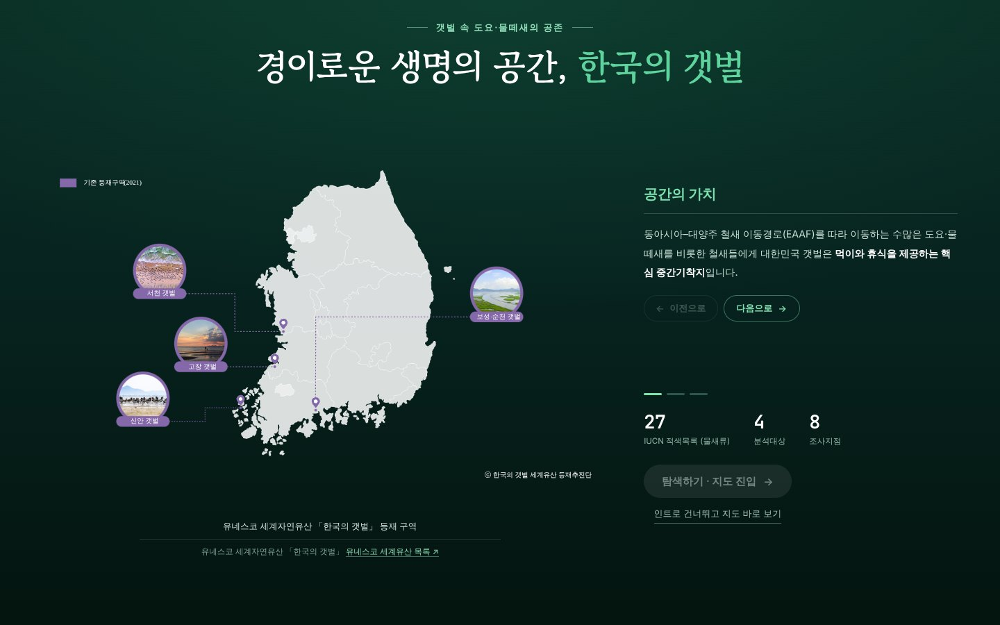
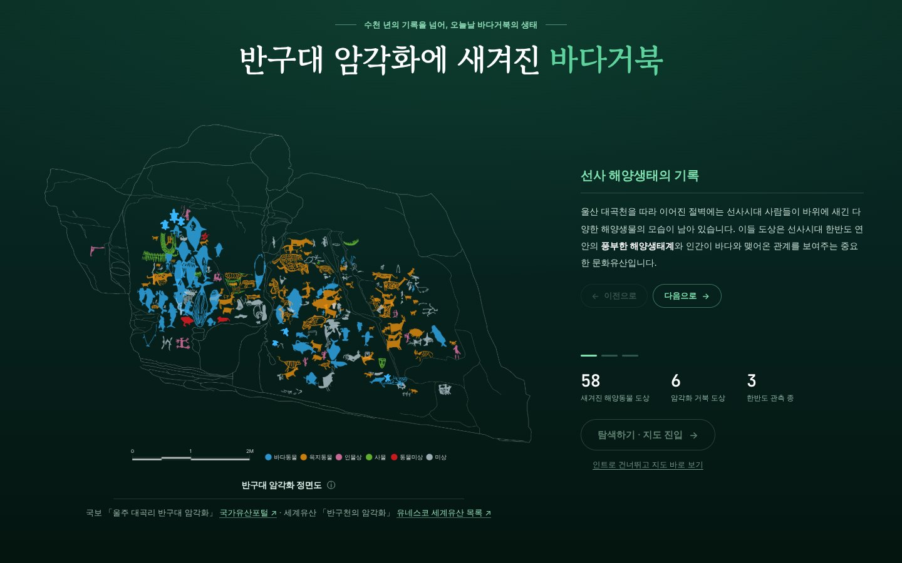
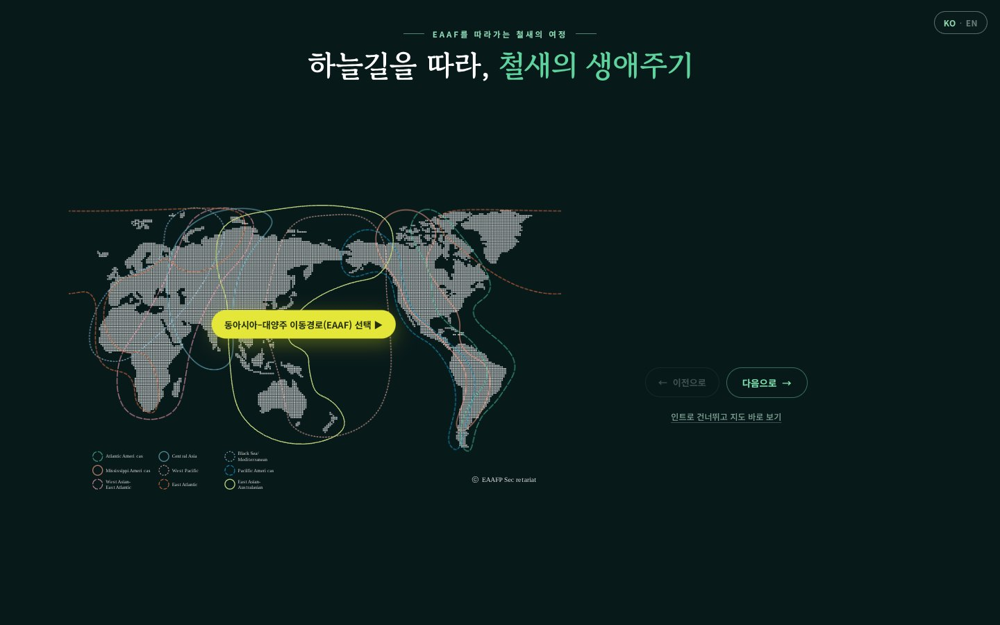
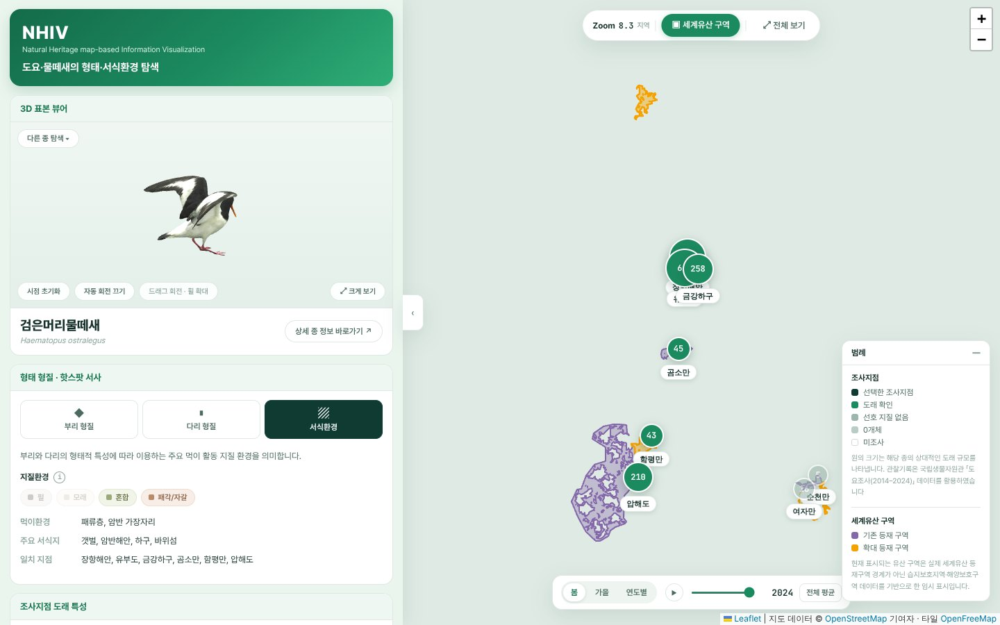
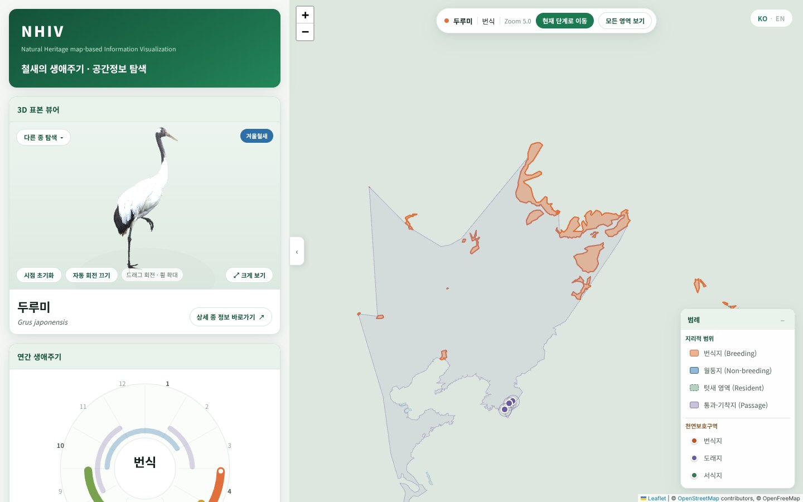

# 04 NHIV: 3D Digital Specimens in Map-Based Narratives of Natural Heritage

Three editions, each a single web page: [Shorebirds of the Korean tidal flats](https://nhiv-shorebird.vercel.app/), [Sea turtles from petroglyph to ocean](https://nhiv-sea-turtle-five.vercel.app/), and [The life cycle of migratory birds](https://nhiv-migratory-bird.vercel.app/). The interfaces are in Korean; the migratory-bird edition also offers English.

## Research overview

Digitised 3D specimens are usually viewed one object at a time, detached from the places, seasons and histories that make a species natural heritage. NHIV (Natural Heritage map-based Information Visualization) explores how 3D digital specimens can instead serve as entry points to those contexts. Each edition starts from a heritage question, introduces the species through 3D specimen models whose features are explained on the model itself, and continues on a map with occurrence, survey, tracking or range data. The specimens come from the same digitisation programme and database as [NEXUS](../03_nexus-natural-heritage/).

## Narrative structure

Every edition follows the same four stages, so a reader can move from a heritage question to evidence on the map without changing interfaces.

1. **Heritage introduction.** A short sequence of steps sets out why the place or species matters, with links to the official heritage listing.
2. **3D specimen viewer.** glTF models of the specimens, with hotspots on the model that explain morphological features. Comparison viewers place several species side by side.
3. **Map exploration.** Observation, survey, tracking or range data at the scale of the region, the country or the globe, with time controls where the data allow.
4. **Synthesis.** Species information and a combined analysis linking morphology, habitat and movement.

## Three editions

| | Heritage question | 3D specimens | Map evidence |
|---|---|---|---|
| **Shorebirds** | The *Getbol* tidal flats (UNESCO World Heritage) as feeding and resting places on the East Asian–Australasian Flyway, and how many shorebirds share them | Four species compared, with beak and tarsus lengths scaled to measured medians and a translucent plane at tarsus height, linking morphology to sand, gravel and mud microhabitats | Eight survey sites from the national shorebird survey (2014–2024), with arrival scale by site and year |
| **Sea turtles** | Turtle figures carved in the Bangudae petroglyphs (*Petroglyphs along the Bangucheon Stream*, UNESCO World Heritage) as a record of prehistoric marine ecology | Three species seen in Korean waters today, compared by beak shape, carapace structure and head proportions | Global and Korean occurrence records, and satellite tracks of tagged turtles with playback, highlighting rescued and released individuals |
| **Migratory birds** | The East Asian–Australasian Flyway among the world's flyways, and the annual cycle of a migratory species such as the red-crowned crane | Specimens of migratory species, with their annual cycle (egg-laying, incubation, chick-rearing, migration and stopover, wintering) | Breeding, non-breeding, resident and passage ranges, and the natural-monument protected areas linked to each stage |

| Shorebirds | Sea turtles | Migratory birds |
|---|---|---|
|  |  |  |
|  |  |  |

*The map screenshots were captured without basemap tiles, which the capture environment could not load; the live pages show them.*

## Interpretive basis and data

Each edition states the basis of its interpretation where readings could differ. Researchers interpret the turtle figures on the rock face differently, so the sea-turtle edition visualises them after the official drawings of the 2014 cleaning and 3D survey of the Bangudae petroglyphs. The shorebird edition notes that the heritage areas on its map are drawn from wetland and marine protected-area data as a provisional display, not from the official World Heritage boundaries.

Each edition is a static page built with Three.js (GLTF and Draco loaders) for the specimen models and Leaflet with vector basemaps for the maps, and is deployed on Vercel.

**Data sources:** shorebird survey records from the National Institute of Biological Resources; protected areas from the World Database on Protected Areas (WDPA); sea-turtle occurrence records from OBIS and the National Marine Biodiversity Institute of Korea (MABIK); satellite tracks from MABIK's marine bioresource information system (MBRIS) via the Public Data Portal; petroglyph drawings from the Korea Heritage Service digital service; natural-monument protected areas from the Korea Heritage Service geographic information service; species ranges from the IUCN Red List; basemaps © OpenStreetMap contributors, OpenMapTiles and OpenFreeMap.

## Contribution and scope

NHIV shows how 3D digital specimens can be placed inside ecological and cultural narratives rather than in a gallery of isolated objects: morphology is read on the model, habitat and movement on the map, and heritage value in the sources that record it, with each layer credited to its data provider. It is a visualisation project. No user evaluation is reported here, the data were compiled from public sources at a point in time, and some map layers (such as the World Heritage areas in the shorebird edition) are provisional displays.

The project was directed by the portfolio author (concept, data model, narrative and interface design). Project-specific responsibilities are recorded in [CONTRIBUTIONS.md](../CONTRIBUTIONS.md).
