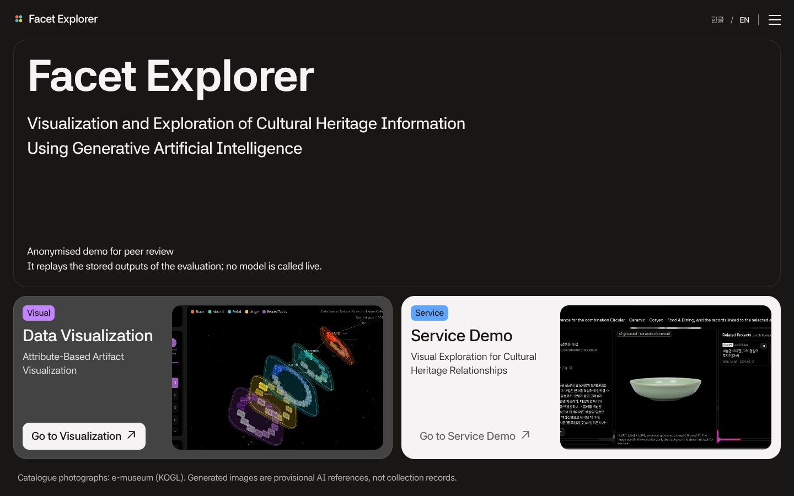
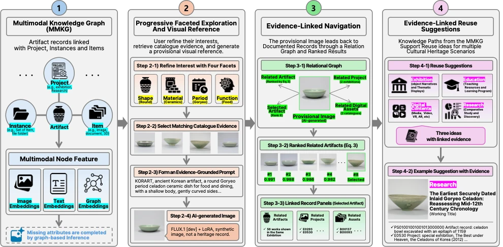
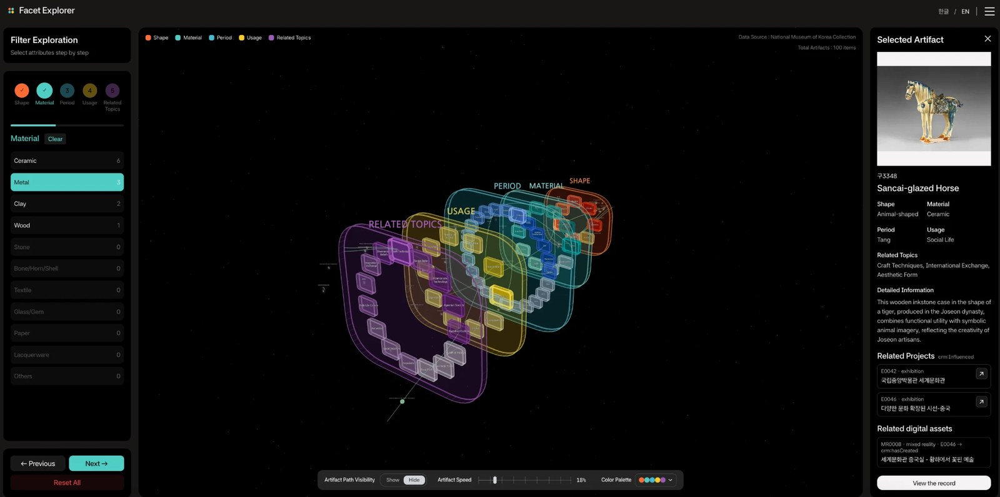

# 05 H+Low: Evidence-Grounded Generative Exploration of Museum Collections

[Open the research demonstration (Facet Explorer)](https://generativeaiheritageexploration.vercel.app/?lang=en), which replays stored evaluation outputs without calling a model live. LoRA training data in [korart-lora-data](https://github.com/yeeunlee2062/korart-lora-data).

## Research overview

Digitisation has widened access to museum collections, but access does not make them easier to explore. Collection systems rely on institutional descriptions and controlled vocabularies that assume users can formulate a query, whereas non-expert interests often form only through encounters with unfamiliar objects. Generative interfaces suggest a way to articulate such an interest, by showing an interpretation of an evolving request before the next step. In cultural heritage this raises an epistemic problem: plausible synthetic images can be mistaken for documentary evidence.

This project therefore treats generation as a **provisional visual reference**, not as a reconstruction or a new heritage record. Attributes chosen by the user are grounded in documented collection data, and the generated image externalises the current direction of inquiry before returning the user to verifiable artifacts and relations in a multimodal knowledge graph (MMKG). The study asks:

- **RQ1.** How reliably can the MMKG support the move from incomplete metadata to evidence-grounded provisional visual references?
- **RQ2.** Does attribute-guided visual exploration make exploratory search accessible across levels of heritage expertise?
- **RQ3.** Does relation-based exploration support traceable, reuse-oriented search better than keyword retrieval?

## System design

The system connects an initially indeterminate interest to verifiable collection resources in four stages. Faceted selection narrows the information space, matching catalogue records ground a provisional image, the image leads back to documented artifacts and their relations, and the retrieved knowledge paths become the evidence for reuse ideas. Synthetic outputs are kept outside the collection graph throughout.

## Multimodal knowledge graph and attribute completion

The MMKG integrates catalogue records from e-museum, the national portal for Korean museum collections, with documentation of the exhibitions, education, research and digitisation activities that involve the same objects. Its schema follows a museum digital-heritage relation specification aligning Dublin Core, CIDOC CRM, Schema.org, CARARE and BIBFRAME 2.0 with the national collection standard. Four levels are distinguished: **Work** (artifact, 3,525), **Project** (activity, 632), **Instance** (digital representation or derivative, 1,560) and **Item** (file, 6,173), with nation, period, material and function as shared attribute nodes; the graph holds 11,988 nodes and 28,262 edges. Projects relate to Works through `crm:Influenced` and to Instances through `crm:hasCreated`; Instances relate to Works through `Digitized` and to Items through `hasPart`. A **knowledge path** is a sequence of connected nodes starting from a Work, limited to two hops.

Missing period, material and function values are completed by GraphSAGE node classification over sentence and CLIP embeddings and graph neighbourhoods. A value is assigned only above the lowest confidence threshold that reaches 90 % validation accuracy, and inferred values remain marked as such. This filled 112 periods, 21 materials and 295 functions, with 88.5–91.5 % accuracy on accepted test predictions.

## Attribute-guided visual reference and reuse ideation

Exploration proceeds through shape, material, period and function. Shape was defined with a heritage expert as a visually accessible facet; the others follow the catalogue vocabularies. Candidate values are ordered by the number of complete attribute combinations they keep reachable, and values that lead nowhere are excluded. Once a combination is complete, the five catalogue records nearest to the CLIP centroid of the matching artifacts serve as evidence. A language model (GPT-4.1) writes a prompt of at most 60 words with a **feature ledger** linking every visual feature to its source artifact and record field, and FLUX.1 [dev], optionally with a LoRA adapter trained on catalogue photographs, renders the image. The result is labelled as AI-generated, shown beside its evidence, and never written into the MMKG.

For a selected artifact, related Projects and Instances are retrieved through SPARQL over the knowledge paths and assembled into a structured context. GPT-5.1 proposes three reuse ideas (exhibition, education, digital content or research), each citing only identifiers from that context and listing reusable digital assets only where the graph records them.

## Three-dimensional relational visualisation

The Data Visualization component presents the collection as a three-dimensional force-directed network. Attribute values (shape, material, period, usage and related topics) form layered planes, artifacts connect to the values assigned to them, and links between values are weighted by their normalised co-occurrence. Users filter step by step and move between attribute and artifact levels. Selecting an artifact highlights its attribute configuration and opens its record, related Projects and related digital assets along the MMKG knowledge paths.

Related artifacts are ranked twice. A generated reference is matched back to documented artifacts by image similarity and attribute agreement (weights 0.6 and 0.4). A selected artifact's neighbours are retrieved by catalogue-text similarity and re-ranked with attribute co-occurrence.

## Evaluation

| Component | Design | Main finding |
|---|---|---|
| Attribute completion | GraphSAGE vs. feature-only baseline | Higher macro-F1 for all three attributes, largest for period and material |
| Visual references | 2 × 2 design (keyword vs. evidence-grounded prompt, with and without LoRA); 100 combinations, 1,600 images, plus a 768-image hold-out | Grounding roughly doubled combination identification (DINOv2 MRR 0.202 → 0.418 with LoRA; real photographs 0.548) and held for artifacts excluded from the evidence (0.177 → 0.333 without LoRA). LoRA mainly improved photographic appearance (lower KID) |
| Expert assessment | Five independent heritage experts; 40 combinations, 200 images | Grounding raised period and function fidelity and usefulness, and reduced ratings noting an error from 0.650 to 0.475. Period style and inscriptions remain the main errors |
| Reuse ideation | 90 artifacts, with vs. without knowledge paths | 98.1 % of ideas cited a related Project or Instance; no citation fell outside the supplied context; 83.1 % of asset claims were backed by an Instance linked to the artifact |
| User study 1 | 29 participants | Favourable ratings, with no difference between experts and non-experts |
| User study 2 | 20 participants, within-subject vs. keyword search on three public portals | Higher ratings for contextual exploration, ideation support and relation understanding; 8.5 vs. 11.9 minutes; idea originality 4.25 vs. 2.95. Perceived evidential grounding did not differ |

## Contribution and scope

The project repositions generation in heritage information seeking, from autonomous content production to an evidence-linked intermediary that makes collection resources perceptible, navigable and traceable. It also separates **provenance grounding** (an idea can be traced to documented records) from stronger **object-specific grounding**: a resource linked through a shared exhibition does not necessarily depict the selected artifact, so evidential reliability depends on the semantics of the relations as well as on whether a source can be cited. The findings are bounded by a single museum collection, partly reconstructed Project–Work relations, small expert and user samples, one comparative task, and the use of externally hosted models.

Outputs:
- Journal manuscript under review (2026)
- *From Intent to Artifact: Agent-Mediated Visual Exploration of Cultural Heritage with Generative AI*, ACM CHI 2026 workshop
- *Interactive Information Exploration Framework of Cultural Heritage with Generative AI*, IEEE ISMAR 2025
- Interpretation Prize, ICOM-AVICOM F@IMP Festival 2024–2025, for the first H+Low prototype, *H+Low: Visual Exploration of Cultural Heritage with Generative AI* (contributing researcher)

The work presented here covers the knowledge-graph construction and attribute completion, the exploration, ranking and visualisation design, prompt grounding and generation experiments, reuse ideation, and the expert and user evaluations. Catalogue photographs: e-museum, National Museum of Korea (KOGL type 1). Project-specific responsibilities are recorded in [CONTRIBUTIONS.md](../CONTRIBUTIONS.md).
