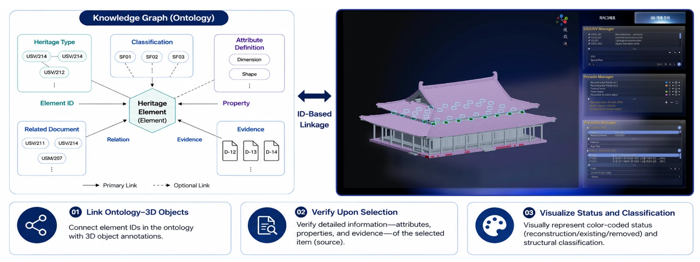
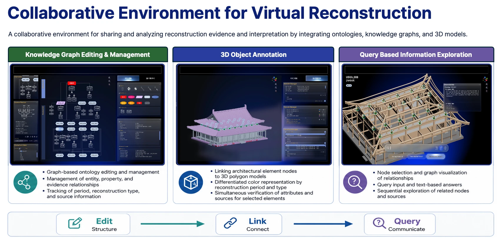

# 06 Time-Space-Evidence: A Collaborative Environment for the Virtual Reconstruction of Traditional Architecture

[Open the collaborative environment prototype](https://time-space-evidence-for-ecosystem.netlify.app/). The semantic framework was presented in *Semantic Reasoning on Stratigraphic Data: A Time-Space-Evidence Framework for Transparent Digital Restoration*, Digital Humanities 2026, Book of Abstracts, pp. 422–423.

## Research overview

East Asian timber buildings decay, and many survive only as platforms and foundation stones. Reconstructing what stood on them depends on inference from excavation records, historical texts, drawings and comparable buildings, and the inference changes with the period and the researcher. The *Seville Principles* (ICOMOS 2011) ask for this reasoning to be documented. Without a transparent record of how sources lead to each reconstructed element, a virtual reconstruction is read as an artistic interpretation rather than as verifiable and reusable scholarly data. Differences in vocabulary between disciplines make the reasoning harder to check, and exchanges between standards such as IFC and CIDOC CRM can lose data and meaning.

AI applications in architectural heritage have moved from recognition and 3D semantic documentation to generative restoration. They still concentrate on extant objects, however, and generated forms are weakly traceable to the sources behind them. This project takes the opposite starting point: it treats the reconstruction of lost elements as a chain of evidence-based hypotheses, and builds the semantic model and the shared workspace that let architectural historians, archaeologists and digitisation specialists inspect that chain together.

The case is the main hall (*geumdang*) of the Gunsuri Temple Site in Buyeo, a Baekje temple of the Sabi period (538–660) whose name has not survived. The 1935 investigation established a one-pagoda, one-hall layout, with the middle gate, wooden pagoda, main hall and lecture hall on a north–south axis. Of the hall itself, only traces of its two-tier, tile-faced platform, some foundation stones and the footings of missing stones remain. Everything above them has to be inferred. The reconstruction is set at the hall's founding and proceeds from the excavation reports and the remains to the bay spacing, the plan, the structure and finally the elevation, for which contemporaneous Baekje temples are the reference.

## The Time-Space-Evidence semantic model

The model adapts archaeological stratigraphy (Harris 1989) and the Extended Matrix to architecture, and extends them in three directions: **time** covers both historical periods and the interpretive time of successive reconstruction proposals; **space** covers 3D components and their structural relations within the hierarchy of a timber building; and **evidence** links source fragments and their reliability to individual features of an element.

Each architectural element has a reconstruction type that states how much evidence lies behind it:

- **US** (stratigraphic unit): remains excavated in situ, the most definitive physical evidence and the starting point of the reconstruction.
- **USV/s** (structural virtual unit): a hypothesis constrained by extant remains or negative traces, such as the footing of a missing foundation stone.
- **USV/n** (non-structural virtual unit): a hypothesis that rests on comparanda or general rules rather than on physical evidence.

The framework draws selectively on CIDOC CRM extensions: CRMarchaeo for the stratigraphic logic of reconstruction types, CRMdig for the provenance of the 3D models, CRMgeo for combining HBIM coordinates with the archaeological grid, and CRMinf for the argumentation behind each decision. Because these do not cover the hierarchy of East Asian timber members (from bracket sets, *gongpo*, to capital blocks, *judu*, and bracket arms, *cheomcha*) or measurement systems such as those of the *Yingzao Fashi*, the model adds classes for the relations among members and for a Korean component classification, which records how an element is refined across HBIM levels of detail.

## A knowledge graph of the main hall

Element records are entered in a structured sheet with four parts. **Basic information** holds an ID that encodes the reconstruction type (for example `US_001`), the component class (platform, columns and walls, bracket sets, roof framing, roof, and openings, each subdivided down to a specific member) and the 3D model file. **Properties** follow a controlled list of attribute types; the current records give material, height, diameter and width. **Related elements** are recorded by ID, with a field for the reason. **Sources** are recorded with what each one is used to establish. The sheet describes 64 elements of the hall. Two are excavated units (the tile-faced platform and the square foundation stones of the outer lean-to bay), one is a structural virtual unit, and 61 are non-structural virtual units inferred from comparanda and rules. The sources cover the site and comparable halls in Korea and Japan (Sacheonwangsa, Hwangnyongsa, Mireuksa, Hōryū-ji): excavation and research reports, the photographs and figures in them, and articles and theses.

The graph is generated from the sheet as a Neo4j import of 1,983 nodes in 16 classes and 4,628 relationships of 18 types. The architectural element is the central class, and every judgement about an element is a separate assertion: 64 reconstruction-type and 64 component-type assertions (against a hierarchy of 94 component types), 256 property assertions and 218 relation assertions, each linked to the reconstruction version it belongs to. Evidence is split into 143 sources (117 photographs and figures, 17 articles and theses, 8 reports and one drawing set) and 500 fragments, each being the figure, passage or value used for one element. Every fragment has a support assessment. Where a source's stated purpose names a property, the assessment is linked to that property assertion (32 links); otherwise it supports the element as a whole.

The import keeps the gaps in the source data visible rather than repairing them. Relations that point to elements not yet entered are kept as identifier nodes marked *missing* (3 relations). An ID used for two different elements is split, and the relations to it are marked *ambiguous* (2). Support assessments carry no score and are flagged for review, because the sheet records no expert grading. Reconstruction versions, researchers, alternative hypotheses and 3D proxy objects are not yet instantiated, because the sheet does not provide them; they are to be added only from verified data.

The capital block of the main body (`USV/n_008`) shows the result. It is a non-structural virtual unit with four property assertions (wood; height 385 mm; diameter and width 616 mm) and relations to the column, the bracket arm and the bracket members around it. Its ten evidence fragments come from studies of the *Yingzao Fashi* and its measurement system, reconstruction studies of the main halls of Hwangnyongsa and Mireuksa, bracket sets in Goguryeo tomb murals and early Japanese halls, and the reconstruction of Neungsa in the Baekje Cultural Land.

The model is designed for four kinds of reasoning. Extant evidence constrains the form and location of virtual units, so that foundation stones and footings ground the dimensions and joinery of the timber structure above. Excavation data, historical records such as the *Yingzao Fashi*, and comparable cases cross-verify a proposal through support relations, recording how the sources converge rather than only the result. Competing interpretations, such as the alternative readings of the post holes of the wooden pagoda, are kept side by side as parallel virtual units with their year and author. And support levels (1–5) can be mapped to colour or transparency, so that surviving remains are visibly distinct from inference. The current graph holds the elements, assertions and evidence on which this reasoning rests; hypothesis histories and support levels await expert input.

## Linking the knowledge graph and the 3D proxy model

Element IDs connect the graph to the objects of a 3D proxy model of the hall. Selecting an object shows the attributes, properties and sources of its element, and the model is coloured by status (reconstructed, existing or removed) and by reconstruction period and type. The viewer's managers list the US and USV units, the reconstruction periods, and the paradata of the selected element, including its material, related elements and data sources.

## A collaborative environment for virtual reconstruction

The environment brings the graph and the model together in three functions, which correspond to three steps of collaborative work: edit (structure), link (connect) and query (communicate).

- **Knowledge-graph editing and management.** The ontology is edited as a graph, keeping entities, properties and evidence apart and tracking the period, reconstruction type and source of each statement, with a preview of the source drawing.
- **3D object annotation.** Element nodes are attached to polygon models of the members, coloured by reconstruction period and type, so that an element's attributes and sources can be checked on the model.
- **Query-based exploration.** A question in natural language, such as the dimensions and sources of a column base, returns the matching subgraph with a text answer, from which related nodes and sources can be followed in sequence.

## Contribution and scope

The project treats a virtual reconstruction as an argument rather than an image. Any member of the main hall can be traced from the 3D model to the assertions it rests on, the source fragments that support them and the proposal they belong to, and remains, structural inferences and comparative inferences are distinguished throughout. This makes the paradata of the reconstruction available alongside the model to every discipline involved. The scope is bounded: there is a single case; support levels, reconstruction versions and alternative hypotheses are modelled but not yet instantiated, because the source data do not record them, and the support assessments await expert review; and the environment is a prototype that has not yet been evaluated with users.

Outputs:
- *Semantic Reasoning on Stratigraphic Data: A Time-Space-Evidence Framework for Transparent Digital Restoration*, Digital Humanities 2026, Book of Abstracts, pp. 422–423, first author

The work presented here covers the Time-Space-Evidence ontology, the data-entry scheme and component classification, the knowledge graph and its linkage to the 3D proxy model, and the design and implementation of the collaborative environment. The architectural reconstruction draws on the excavation reports, studies and comparable cases recorded as sources in the graph. Project-specific responsibilities are recorded in [CONTRIBUTIONS.md](../CONTRIBUTIONS.md).
