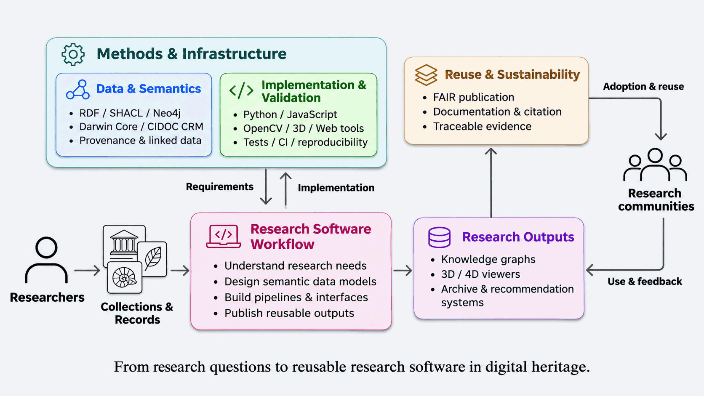

# Digital Heritage Portfolio

I develop research software with humanities and heritage researchers, creating data models, processing pipelines, and interfaces that turn their research questions into practical tools. I rigorously evaluate these tools and publish them to enable inspection and reuse by others. In projects spanning tangible, intangible, and natural heritage, I ensure that each computational result—whether a 3D reconstruction, a recommendation, or a generated image—remains transparently connected to its underlying sources, methodological decisions, and associated uncertainties.

## From research questions to reusable software

**Selected implementations:** [NEXUS: explainable natural-heritage recommendations and reproducibility](03_nexus-natural-heritage/) · [Chunaengjeon: 4D reconstruction and research viewer](02_chunaengjeon-4d/) · [Hansan Mosi: linked data and FAIR validation](01_hansan-mosi-scene-archive/)

**Skills**: Python (NumPy, PyTorch, OpenCV, rdflib/pySHACL), JavaScript/TypeScript (React, Vite, Three.js, WebGL2), knowledge graphs (RDF, SHACL, SPARQL, Neo4j/Cypher, CIDOC CRM), PostgreSQL/Supabase, applied ML (CLIP, GraphSAGE, LoRA, LLMs), 3D/4D capture and Gaussian Splatting, FAIR data and software

## Research Projects

| Project | Research | Description | Outcomes |
|---|---|---|---|
| [Hansan Mosi Weaving](01_hansan-mosi-scene-archive/) | *Scene-Centred Semantic Modeling of Intangible Heritage* | This project investigates how the knowledge embodied in traditional weaving can be documented through relationships among actions, tools, materials, and practitioners. A scene-centered knowledge graph contextualizes a volumetric weaving performance, a 3D reconstruction of the weaving space, and a digital loom through spatial and temporal annotations, provenance, and rights information.  **Role:** Semantic model, knowledge graph, archive platform and annotation tools, FAIR export and validation. **Stack:** TypeScript, Vite, Three.js, Gaussian-splat and volumetric viewers, Supabase/PostgreSQL, RDF, SHACL. | [Interactive archive](https://hansan-mosi-archive.vercel.app/), [Semantic model and validation](01_hansan-mosi-scene-archive/data-model/) |
| [Chunaengjeon in 4D](02_chunaengjeon-4d/) | *Volumetric Reconstruction and Semantic Interpretation of Traditional Performance* | This research examines how volumetric recordings can function as temporally addressable sources for the study of performance. A reconstruction pipeline converts 32-camera capture data into per-frame 3D Gaussian Splatting, while an interpretation platform relates recorded movements to their musical, textual, spatial, and transmission contexts.  **Role:** Camera registration and per-frame 3DGS pipeline, web sequence format and WebGL2 player, scene database, interpretation platform. **Stack:** Python, OpenCV, PyTorch, gsplat, JavaScript, WebGL2. | [4D interpretation platform](https://chunaengjeon-4d.vercel.app/) , [Reconstruction pipeline](02_chunaengjeon-4d/pipeline/) |
| [NEXUS](03_nexus-natural-heritage/) | *Explainable Knowledge-Graph Recommendation for Natural Heritage* | The study develops and evaluates a user-adaptive recommendation method for exploring heterogeneous natural-heritage records. Recommendations are derived from semantic relationships and user profiles, with graph paths retained to make the basis of each suggestion interpretable. The findings were published in *Applied Sciences* (2026).  **Role:** First author; data model, ontologies, ranking model, evaluation, reproducibility package. **Stack:** Neo4j/Cypher, Python, Node.js, Smithsonian Voyager. | [NEXUS platform](https://natural-extended-specimen.netlify.app/) , [Published article](https://doi.org/10.3390/app16199955) , [Reproducibility materials](03_nexus-natural-heritage/reproducibility/) |
| [NHIV](04_nhiv-3d-specimen-maps/) | *Geospatial Visualization and 3D Interpretation of Natural Heritage* | This independent visualization project explores how digital specimen models can be situated within ecological and cultural narratives through interactive maps. Three thematic interfaces connect the morphology of shorebirds, sea turtles, and migratory birds to their habitats, distributions, movement patterns, and relevant cultural contexts.  **Role:** Project direction; concept, data model, narrative and interface design. **Stack:** Three.js (glTF, Draco), Leaflet, vector basemaps. | [Shorebirds](https://nhiv-shorebird.vercel.app/) , [Sea turtles](https://nhiv-sea-turtle-five.vercel.app/) , [Migratory bird life cycles](https://nhiv-migratory-bird.vercel.app/) |
| [H+Low](05_generative-heritage-exploration/) | *Evidence-Grounded Generative Exploration of Museum Collections* | This project investigates an iterative approach to collection exploration in which users progressively refine visual inquiries through object attributes. A multimodal knowledge graph connects AI-generated visual references to documented collection records, allowing generated interpretations to be distinguished from and examined against their underlying evidence.  **Role:** First author; multimodal knowledge graph and attribute completion, exploration design, generation experiments, expert and user evaluations. **Stack:** Python, GraphSAGE, CLIP, FLUX.1 with LoRA, GPT models, SPARQL, 3D force-directed graph. | [Research demonstration](https://generativeaiheritageexploration.vercel.app/) , [LoRA training data](https://github.com/yeeunlee2062/korart-lora-data) |
| [TSE Collaborative Environment](06_tse-collaborative-environment/) | *Time-Space-Evidence Modeling for Transparent Virtual Reconstruction* | This research addresses the traceability of reasoning in the virtual reconstruction of lost architectural elements. A Time-Space-Evidence ontology, adapted from archaeological stratigraphy and CIDOC CRM extensions, structures the main hall of a Baekje temple site as a knowledge graph in which each reconstructed element is linked to its supporting sources, competing hypotheses, and a 3D proxy model, within a collaborative environment for multidisciplinary experts.  **Role:** First author; ontology, data-entry scheme, knowledge graph, collaborative environment. **Stack:** Neo4j/Cypher, CIDOC CRM extensions, web-based 3D annotation. | [Collaborative environment prototype](https://time-space-evidence-for-ecosystem.netlify.app/) , [Semantic model and methodology](06_tse-collaborative-environment/) |
| [FAIR Maturity Assessment](07_fair-assessment/) |* Operationalizing FAIR for 3D/4D Heritage Data* | This assessment examines the distinction between interoperability provisions specified in a data model and those demonstrably available in a deployed archive. The RDA FAIR Data Maturity Model is applied at the indicator level to document existing capabilities and unresolved requirements for persistent identification, access, interoperability, and reuse.  **Role:** Indicator-level assessments, supplementary specifications, FAIR export and publication. **Stack:** RDA FAIR Data Maturity Model, RDF/JSON-LD, SHACL, DCAT, schema.org, OAI-PMH. | [Assessment methodology and results](07_fair-assessment/) |

## Research Software Practice

- **Code to look at first**: the [volumetric reconstruction pipeline](02_chunaengjeon-4d/pipeline/) (camera registration, per-frame 3DGS training, a quantised web format with a reference decoder), the [interpretation platform](02_chunaengjeon-4d/platform/) and its WebGL2 player, the [linked-data model with SHACL validation](01_hansan-mosi-scene-archive/data-model/), and the [reproducibility package](03_nexus-natural-heritage/reproducibility/) of the NEXUS article.
- **Tests and CI**: the [test suite](tests/) runs on every push. It checks the splat format against its quantization bounds and the published frames, the integrity of the dance database and its frame ranges, SHACL conformance and JSON-LD/Turtle equivalence of the archive records, byte-identical reproduction of the NEXUS results with checksums, and every relative link in the documentation. Run it with `pip install "./tests[test]"` and `pytest tests`.
- **Working with researchers**: requirements come from expert interviews, Kano–QFD analysis, competency questions agreed before implementation, and the researchers' own workbooks as the source of truth.
- **Reproducible and FAIR**: deterministic builds that record tool versions and input hashes, SHA-256 fixity, linked-data publication with DCAT and content negotiation, an open license and citation metadata. Requirements not yet met, and partial results, are stated on the project pages.

## Repository Scope and Attribution

This repository presents selected research implementations and their supporting materials rather than complete project archives. Publicly available resources include case-study descriptions, visualizations, metadata models, annotation and validation materials, reconstruction code, and documented reproducibility packages. Raw volumetric captures, personal information, licensed data, and some unpublished research resources remain in their respective project environments. Individual project pages specify the evidence that can be inspected and the limitations of its release.

Project-specific research roles and partner institutions are described in [CONTRIBUTIONS.md](CONTRIBUTIONS.md) using the CRediT taxonomy, together with a statement on the use of AI coding assistants for code design. Citation metadata for this repository is provided in [CITATION.cff](CITATION.cff). Repository code is licensed under [MIT](LICENSE), while author-owned text and figures are made available under [CC BY 4.0](CONTRIBUTIONS.md#licences); third-party materials remain subject to their original conditions of use.

Research represented in this portfolio has received support from the Ministry of Culture, Sports and Tourism through the Korea Creative Content Agency (KOCCA; RS-2026-25531229, RS-2024-00442308, RS-2023-00219579) and from the Korea Heritage Service through the National Research Institute of Cultural Heritage (RS-2026-25536820). Project-specific acknowledgments are provided in the corresponding research outputs.
