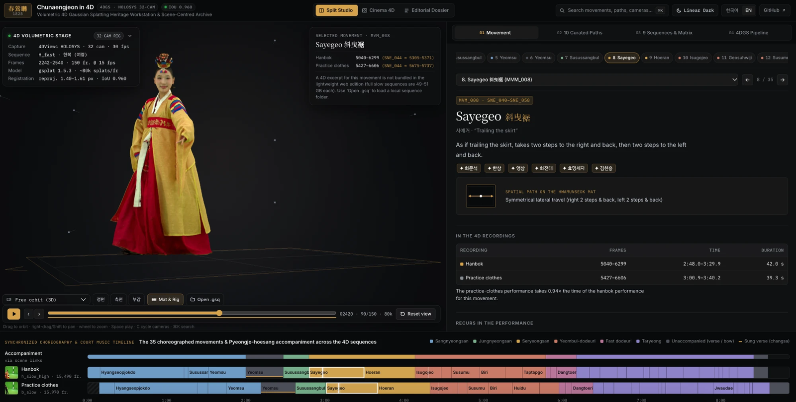
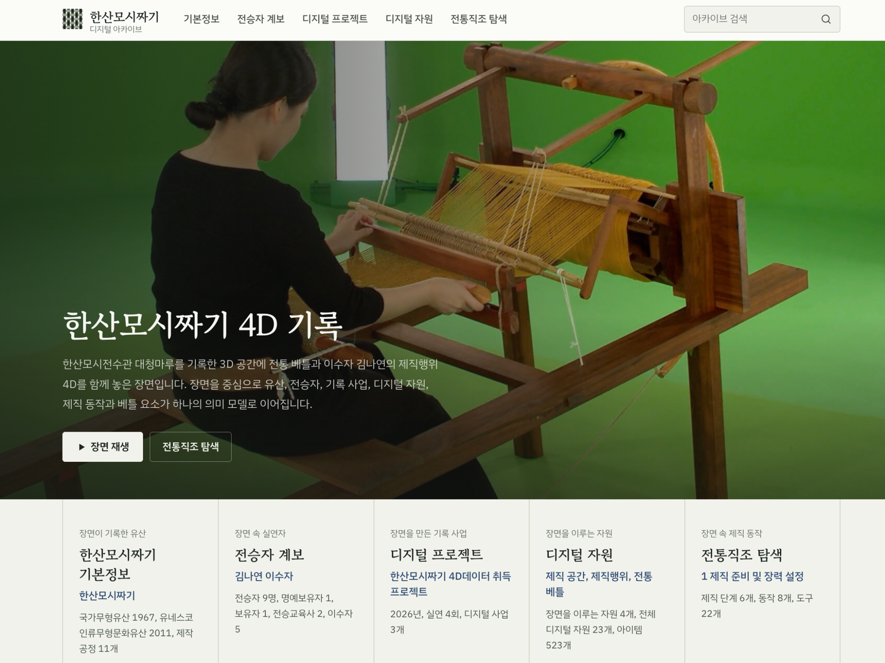
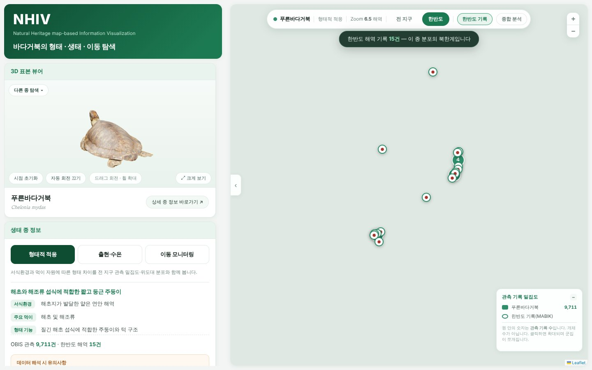

# Digital Heritage Portfolio

The scholarly value of a digital heritage record depends not only on the fidelity of its representation but also on whether the knowledge and evidence associated with its creation can be preserved and critically examined. The research presented in this portfolio investigates how three-dimensional and time-dependent heritage records can be connected to semantic descriptions, documented sources, and interfaces for scholarly interpretation. Through studies of tangible, intangible, and natural heritage, it considers how computational methods can support contextual understanding, transparent documentation, and the sustained reuse of digital resources.

**Research areas**: Digital Heritage, Digital Humanities, 3D/4D Heritage Documentation, Data Visualization, Knowledge Graph, Semantic Web, Artificial Intelligence, Digital Curation and Preservation

| Chunaengjeon: 4D performance interpretation | Hansan Mosi: scene-centred archive | NHIV: 3D specimens and spatial narratives |
|:---:|:---:|:---:|
|  |  |  |

## Research Projects

| Project | Research | Description | Outcomes |
|---|---|---|---|
| [Hansan Mosi Weaving](01_hansan-mosi-scene-archive/) | *Scene-Centred Semantic Modelling of Intangible Heritage* | This project investigates how the knowledge embodied in traditional weaving can be documented through relationships among actions, tools, materials, and practitioners. A scene-centred knowledge graph contextualises a volumetric weaving performance, a 3D reconstruction of the weaving space, and a digital loom through spatial and temporal annotations, provenance, and rights information.  **Role:** Semantic model, knowledge graph, archive platform and annotation tools, FAIR export and validation. **Stack:** TypeScript, Vite, Three.js, Gaussian-splat and volumetric viewers, Supabase/PostgreSQL, RDF, SHACL. | [Interactive archive](https://hansan-mosi-archive.vercel.app/), [Semantic model and validation](01_hansan-mosi-scene-archive/data-model/) |
| [Chunaengjeon in 4D](02_chunaengjeon-4d/) | *Volumetric Reconstruction and Semantic Interpretation of Traditional Performance* | This research examines how volumetric recordings can function as temporally addressable sources for the study of performance. A reconstruction pipeline converts 32-camera capture data into per-frame 3D Gaussian Splatting, while an interpretation platform relates recorded movements to their musical, textual, spatial, and transmission contexts.  **Role:** Camera registration and per-frame 3DGS pipeline, web sequence format and WebGL2 player, scene database, interpretation platform. **Stack:** Python, OpenCV, PyTorch, gsplat, JavaScript, WebGL2. | [4D interpretation platform](https://chunaengjeon-4d.vercel.app/) , [Reconstruction pipeline](02_chunaengjeon-4d/pipeline/) |
| [NEXUS](03_nexus-natural-heritage/) | *Explainable Knowledge-Graph Recommendation for Natural Heritage* | The study develops and evaluates a user-adaptive recommendation method for exploring heterogeneous natural-heritage records. Recommendations are derived from semantic relationships and user profiles, with graph paths retained to make the basis of each suggestion interpretable. The findings were published in *Applied Sciences* (2026).  **Role:** First author; data model, ontologies, ranking model, evaluation, reproducibility package. **Stack:** Neo4j/Cypher, Python, Node.js, Smithsonian Voyager. | [NEXUS platform](https://natural-extended-specimen.netlify.app/) , [Published article](https://doi.org/10.3390/app16199955) , [Reproducibility materials](03_nexus-natural-heritage/reproducibility/) |
| [NHIV](04_nhiv-3d-specimen-maps/) | *Geospatial Visualisation and 3D Interpretation of Natural Heritage* | This independent visualisation project explores how digital specimen models can be situated within ecological and cultural narratives through interactive maps. Three thematic interfaces connect the morphology of shorebirds, sea turtles, and migratory birds to their habitats, distributions, movement patterns, and relevant cultural contexts.  **Role:** Project direction; concept, data model, narrative and interface design. **Stack:** Three.js (glTF, Draco), Leaflet, vector basemaps. | [Shorebirds](https://nhiv-shorebird.vercel.app/) , [Sea turtles](https://nhiv-sea-turtle-five.vercel.app/) , [Migratory bird life cycles](https://nhiv-migratory-bird.vercel.app/) |
| [H+Low](05_generative-heritage-exploration/) | *Evidence-Grounded Generative Exploration of Museum Collections* | This project investigates an iterative approach to collection exploration in which users progressively refine visual enquiries through object attributes. A multimodal knowledge graph connects AI-generated visual references to documented collection records, allowing generated interpretations to be distinguished from and examined against their underlying evidence.  **Role:** First author; multimodal knowledge graph and attribute completion, exploration design, generation experiments, expert and user evaluations. **Stack:** Python, GraphSAGE, CLIP, FLUX.1 with LoRA, GPT models, SPARQL, 3D force-directed graph. | [Research demonstration](https://generativeaiheritageexploration.vercel.app/) , [LoRA training data](https://github.com/yeeunlee2062/korart-lora-data) |
| [TSE Collaborative Environment](06_tse-collaborative-environment/) | *Time-Space-Evidence Modelling for Transparent Virtual Reconstruction* | This research addresses the traceability of reasoning in the virtual reconstruction of lost architectural elements. A Time-Space-Evidence ontology, adapted from archaeological stratigraphy and CIDOC CRM extensions, structures the main hall of a Baekje temple site as a knowledge graph in which each reconstructed element is linked to its supporting sources, competing hypotheses, and a 3D proxy model, within a collaborative environment for multidisciplinary experts.  **Role:** First author; ontology, data-entry scheme, knowledge graph, collaborative environment. **Stack:** Neo4j/Cypher, CIDOC CRM extensions, web-based 3D annotation. | [Collaborative environment prototype](https://time-space-evidence-for-ecosystem.netlify.app/) , [Semantic model and methodology](06_tse-collaborative-environment/) |
| [FAIR Maturity Assessment](07_fair-assessment/) | *Operationalising FAIR for 3D/4D Heritage Data* | This assessment examines the distinction between interoperability provisions specified in a data model and those demonstrably available in a deployed archive. The RDA FAIR Data Maturity Model is applied at the indicator level to document existing capabilities and unresolved requirements for persistent identification, access, interoperability, and reuse.  **Role:** Indicator-level assessments, supplementary specifications, FAIR export and publication. **Stack:** RDA FAIR Data Maturity Model, RDF/JSON-LD, SHACL, DCAT, schema.org, OAI-PMH. | [Assessment methodology and results](07_fair-assessment/) |

## Research Themes and Methods

| Theme | Approach, standards and tools | Projects |
|---|---|---|
| **3D/4D records as knowledge sites** | A 3D or 4D model is placed at the centre and linked to annotations, narratives and records through domain-specific semantic models. Knowledge graphs are built in Neo4j/Cypher and RDF (Turtle, JSON-LD) with SHACL validation and are aligned with CIDOC CRM and its extensions; EDM, Dublin Core, LIDO, W3C PROV and Darwin Core inform selected mappings. | [01](01_hansan-mosi-scene-archive/) · [02](02_chunaengjeon-4d/) · [03](03_nexus-natural-heritage/) · [06](06_tse-collaborative-environment/) |
| **3D/4D capture and web delivery** | Photogrammetry and volumetric capture, camera registration and per-frame 3D Gaussian Splatting (gsplat); Alembic, PLY and glTF/GLB, prepared in Blender; quantised splat sequences, Draco compression and Smithsonian Voyager; rendering in the browser with Three.js and WebGL2. | [01](01_hansan-mosi-scene-archive/) · [02](02_chunaengjeon-4d/) · [03](03_nexus-natural-heritage/) · [04](04_nhiv-3d-specimen-maps/) |
| **Paradata and interpretive uncertainty** | Modelling and interpretive decisions are recorded with the data rather than smoothed over: the verification status of annotations, calibration decisions, open questions in the source, and the distinction between remains, structural inferences and comparative inferences. | [01](01_hansan-mosi-scene-archive/) · [02](02_chunaengjeon-4d/) · [06](06_tse-collaborative-environment/) |
| **AI-assisted exploration** | Language models are combined with vision and multimodal models: CLIP representations, GraphSAGE inference, FLUX.1 LoRA fine-tuning and evidence-grounded prompts. Generated outputs are kept apart from collection records and are reviewed by a pool of heritage experts. | [05](05_generative-heritage-exploration/) |
| **From user requirements to evaluated interfaces** | Expert interviews and Kano–QFD analysis are turned into design attributes, and research applications are built in Python, JavaScript/TypeScript, React, Vite and Next.js on PostgreSQL/Supabase, SQLite and Neo4j. Evaluation uses competency questions, ranking analyses, expert assessment and user studies; instruments that are implemented but not yet run are marked as such. | [01](01_hansan-mosi-scene-archive/) · [03](03_nexus-natural-heritage/) · [05](05_generative-heritage-exploration/) · [06](06_tse-collaborative-environment/) |
| **FAIR publication and preservation** | Provenance, version, rights and format metadata, SHA-256 fixity, content negotiation, and DCAT and schema.org descriptions. FAIR provisions are assessed with the RDA FAIR Data Maturity Model against a running service, and pending identifier registration and preservation arrangements are stated as such. | [01](01_hansan-mosi-scene-archive/) · [02](02_chunaengjeon-4d/) · [07](07_fair-assessment/) |

## Repository Scope and Attribution

This repository presents selected research implementations and their supporting materials rather than complete project archives. Publicly available resources include case-study descriptions, visualisations, metadata models, annotation and validation materials, reconstruction code, and documented reproducibility packages. Raw volumetric captures, personal information, licensed data, and some unpublished research resources remain in their respective project environments. Individual project pages specify the evidence that can be inspected and the limitations of its release.

Project-specific research roles and partner institutions are described in [CONTRIBUTIONS.md](CONTRIBUTIONS.md) using the CRediT taxonomy, together with a statement on the use of AI coding assistants for code design. Citation metadata for this repository are provided in [CITATION.cff](CITATION.cff). Repository code is licensed under [MIT](LICENSE), while author-owned text and figures are made available under [CC BY 4.0](LICENSE-CONTENT.md); third-party materials remain subject to their original conditions of use.

Research represented in this portfolio has received support from the Ministry of Culture, Sports and Tourism through the Korea Creative Content Agency (KOCCA; RS-2026-25531229, RS-2024-00442308, RS-2023-00219579) and from the Korea Heritage Service through the National Research Institute of Cultural Heritage (RS-2026-25536820). Project-specific acknowledgements are provided in the corresponding research outputs.
