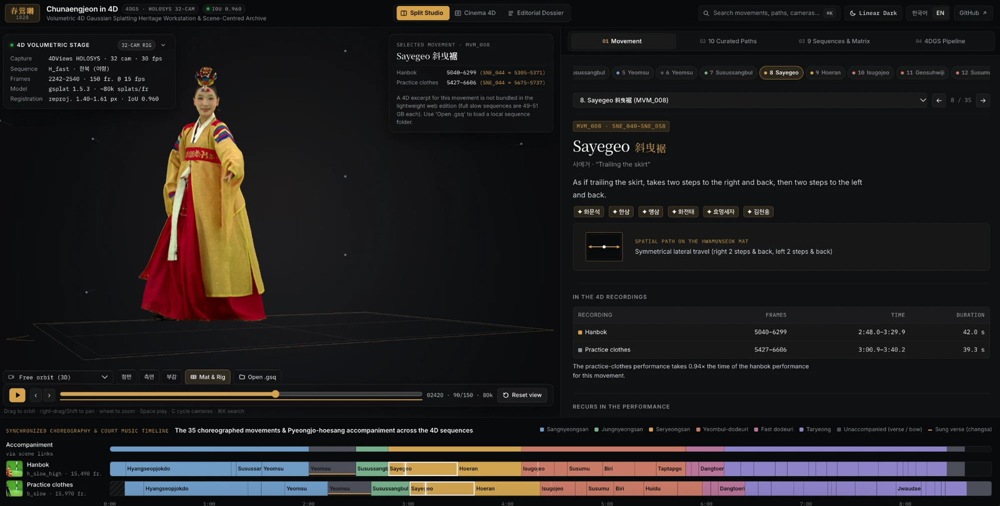
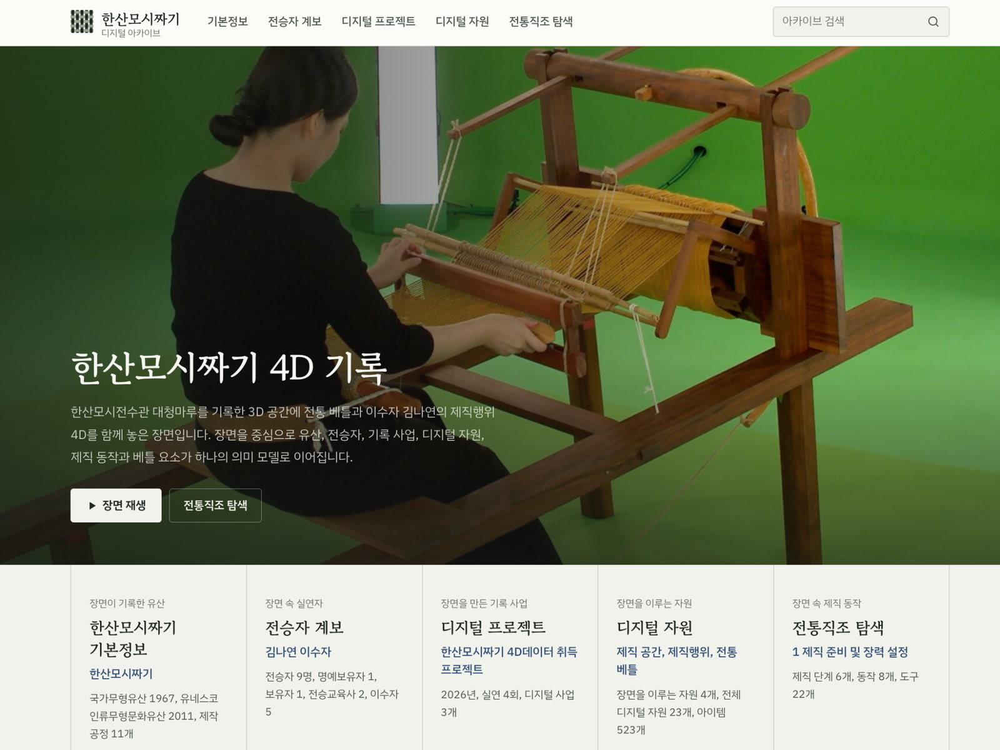
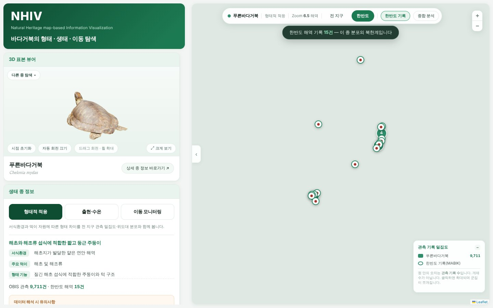

# Research Software for Digital Heritage and the Humanities

[](https://github.com/yeeunlee2062/Digital-Heritage-Portfolio/actions/workflows/ci.yml)
[](LICENSE)
[](LICENSE-CONTENT.md)
[](CITATION.cff)

I build research software with and for humanities and heritage researchers. In these projects I turn a research question from curators, dance and craft practitioners, architectural historians or natural-history specialists into a data model, a processing pipeline and an interface they can work with, then evaluate it and publish it so that others can inspect and reuse it. The projects cover tangible, intangible and natural heritage. The common thread is that a computational result, whether a 3D reconstruction, a recommendation or a generated image, stays linked to the sources, decisions and uncertainty behind it.

**Core skills:** Python (NumPy, PyTorch, OpenCV, rdflib/pySHACL), JavaScript/TypeScript (React, Vite, Next.js, Three.js, WebGL2), knowledge graphs (RDF, SHACL, SPARQL, Neo4j/Cypher, CIDOC CRM), PostgreSQL/Supabase, applied ML (CLIP, GraphSAGE, LoRA fine-tuning, LLMs), 3D/4D capture and Gaussian Splatting, and FAIR data and software publication.

| Chunaengjeon: 4D performance interpretation | Hansan Mosi: scene-centred archive | NHIV: 3D specimens and spatial narratives |
|:---:|:---:|:---:|
| [](02_chunaengjeon-4d/) | [](01_hansan-mosi-scene-archive/) | [](04_nhiv-3d-specimen-maps/) |

## Where to look in the code

If you have ten minutes, these are the parts of the repository that show how I write and test research software.

| What | Where | What it shows |
|---|---|---|
| Volumetric reconstruction pipeline (Python) | [`02_chunaengjeon-4d/pipeline/`](02_chunaengjeon-4d/pipeline/) | Camera registration from a mesh-only export (SIFT, depth lifting, PnP), per-frame 3D Gaussian Splatting training with gsplat, and a quantised streaming format (`.gsq`) with a reference decoder ([`pack_sequence.py`](02_chunaengjeon-4d/pipeline/pack_sequence.py)), tested against its quantisation bounds |
| Browser player and interpretation platform (JavaScript) | [`02_chunaengjeon-4d/platform/`](02_chunaengjeon-4d/platform/) | A WebGL2 player that decodes splat frames in a worker, linked frame by frame to a scene-centred database of the dance that is rebuilt from the researchers' workbook ([`build_data.py`](02_chunaengjeon-4d/platform/tools/build_data.py)) |
| Linked-data model with validation (RDF/SHACL) | [`01_hansan-mosi-scene-archive/data-model/`](01_hansan-mosi-scene-archive/data-model/) | A vocabulary, SHACL shapes, a DCAT catalogue and sample records in JSON-LD and Turtle; the build validates the full export (27,602 triples), and CI checks the published excerpt |
| Reproducibility package of a journal article | [`03_nexus-natural-heritage/reproducibility/`](03_nexus-natural-heritage/reproducibility/) | Competency-question checks with negative controls, and a recomputation of every ranking number reported in *Applied Sciences* (2026), with SHA-256 fixity |
| Tests and CI | [`tests/`](tests/), [`.github/workflows/ci.yml`](.github/workflows/ci.yml) | 38 pytest checks and ruff lint on every push (see [Run the checks](#run-the-checks)) |

## Projects

Each project began with a question asked by domain researchers. The table states what I built and where the results can be inspected. Roles are given with the CRediT taxonomy in [CONTRIBUTIONS.md](CONTRIBUTIONS.md).

| Project | Research problem | What I built | Stack | Open outputs |
|---|---|---|---|---|
| [01 Hansan Mosi Weaving](01_hansan-mosi-scene-archive/) | Documenting a traditional craft as relationships among actions, tools, materials and practitioners, not as separate media files | A scene-centred knowledge graph (705 records, 2,216 relations); an archive with in-browser 3D/4D annotation tools; a deterministic build that exports, validates and loads the data; content negotiation for every record | TypeScript, Vite, Three.js, Supabase/PostgreSQL, Python, RDF, SHACL | [Archive](https://hansan-mosi-archive.vercel.app/) · [Data model and validation](01_hansan-mosi-scene-archive/data-model/) |
| [02 Chunaengjeon in 4D](02_chunaengjeon-4d/) | Making a volumetric dance recording citable by frame range and linked to the named units of the choreography | A pipeline from 32-camera capture to per-frame 3DGS (58,843 frames); a web sequence format and WebGL2 player; a scene database of the dance and the movement annotation that links it to the 4D record | Python, PyTorch, gsplat, OpenCV, JavaScript, WebGL2 | [Platform](https://chunaengjeon-4d.vercel.app/) · [Pipeline](02_chunaengjeon-4d/pipeline/) · [Platform source](02_chunaengjeon-4d/platform/) |
| [03 NEXUS](03_nexus-natural-heritage/) | Exploring heterogeneous natural-heritage records with recommendations that users can understand | Ontologies and a knowledge graph; a user-adaptive ranking engine that keeps the graph path behind each suggestion; the evaluation and a reproducibility package. First author, *Applied Sciences* (2026) | Neo4j/Cypher, Node.js, Python | [Platform](https://natural-extended-specimen.netlify.app/) · [Article](https://doi.org/10.3390/app16199955) · [Reproducibility](03_nexus-natural-heritage/reproducibility/) |
| [04 NHIV](04_nhiv-3d-specimen-maps/) | Placing 3D specimens in the ecological and cultural narratives of their species | Three map-based interfaces that join specimen models to habitats, distributions and migration data (project lead) | Three.js (glTF, Draco), Leaflet | [Shorebirds](https://nhiv-shorebird.vercel.app/) · [Sea turtles](https://nhiv-sea-turtle-five.vercel.app/) · [Migratory birds](https://nhiv-migratory-bird.vercel.app/) |
| [05 H+Low](05_generative-heritage-exploration/) | Using generative AI to explore museum collections without confusing generated images with evidence | A multimodal knowledge graph with attribute completion; stepwise attribute-guided generation; expert and user evaluations. First author | Python, GraphSAGE, CLIP, FLUX.1 with LoRA, GPT models, SPARQL | [Demonstration](https://generativeaiheritageexploration.vercel.app/) · [LoRA training data](https://github.com/yeeunlee2062/korart-lora-data) |
| [06 TSE Collaborative Environment](06_tse-collaborative-environment/) | Keeping the reasoning of a virtual architectural reconstruction traceable for multidisciplinary teams | A Time-Space-Evidence ontology (CIDOC CRM extensions), a knowledge graph of a Baekje temple hall, and a shared 3D workspace linking each element to its sources and competing hypotheses. First author, DH 2026 | Neo4j/Cypher, CIDOC CRM, web 3D annotation | [Prototype](https://time-space-evidence-for-ecosystem.netlify.app/) · [Model and method](06_tse-collaborative-environment/) |
| [07 FAIR Maturity Assessment](07_fair-assessment/) | Testing FAIR claims against a running service rather than a design document | Indicator-level RDA FAIR Data Maturity Model assessments of two archives, with implementable specifications for the gaps | RDF/JSON-LD, SHACL, DCAT, schema.org, OAI-PMH | [Methodology and results](07_fair-assessment/) |

## How I work

**Working with researchers.** Requirements come from the people who will use the software: expert interviews and Kano–QFD analysis (NEXUS), the researchers' own workbooks as the source of truth (Chunaengjeon), and competency questions agreed before implementation (Hansan Mosi, NEXUS). Partner institutions and their roles are listed in [CONTRIBUTIONS.md](CONTRIBUTIONS.md).

**Testing and continuous integration.** The [test suite](tests/) runs on every push and checks:

- that the `.gsq` splat format round-trips within its quantisation step and that the published sample frames decode as the browser decodes them;
- the referential integrity of the Chunaengjeon database, and that every annotated movement addresses a valid, ordered frame range in both recordings;
- that the Hansan Mosi records conform to their SHACL shapes and that their JSON-LD and Turtle serialisations are isomorphic;
- that the NEXUS package still reproduces the article: competency questions pass, the ranking script regenerates its results byte for byte, and all checksums match;
- the repository metadata: citation file, licences, and every relative link in the documentation.

**Reproducibility and provenance.** Builds are deterministic and record their tool versions and input hashes ([example](01_hansan-mosi-scene-archive/data-model/validation_report.md)). Published packages carry SHA-256 checksums. Calibration and modelling decisions are kept with the data as paradata.

**FAIR data and software.** The code is in a public repository under an open licence, with citation metadata. The data are published as linked data with persistent-identifier patterns, DCAT descriptions and content negotiation. Where a FAIR requirement is not yet met, for example registration of the `w3id.org` namespace or deposit in a software registry, the project page says so rather than claiming it.

**Honest reporting.** Instruments that are implemented but not yet run, partial results (such as CQ6 in Hansan Mosi) and corrections to published supplements are stated explicitly on the project pages.

## Run the checks

Python 3.10+ and, for the ranking recomputation, Node.js 18+.

```bash
pip install -r requirements-test.txt
```

```bash
pytest -v
```

```bash
ruff check .
```

The GPU reconstruction pipeline (CUDA, PyTorch and gsplat; [`requirements.txt`](02_chunaengjeon-4d/pipeline/requirements.txt)) needs the raw capture data, which is not part of this repository. Its storage format and decoder are tested without a GPU.

## Repository scope and attribution

This repository presents selected research implementations and their supporting materials, not complete project archives. It contains case-study descriptions, visualisations, metadata models, annotation and validation materials, reconstruction code, and documented reproducibility packages. Raw volumetric captures, personal information, licensed data and some unpublished research resources remain in their project environments. Each project page states what can be inspected and the limits of its release.

Research roles and partner institutions are described in [CONTRIBUTIONS.md](CONTRIBUTIONS.md) with the CRediT taxonomy, together with a statement on the use of AI coding assistants. Citation metadata are in [CITATION.cff](CITATION.cff). Code is licensed under [MIT](LICENSE); author-owned text and figures are under [CC BY 4.0](LICENSE-CONTENT.md); third-party materials keep their original terms.

The research has been supported by the Ministry of Culture, Sports and Tourism through the Korea Creative Content Agency (KOCCA; RS-2026-25531229, RS-2024-00442308, RS-2023-00219579) and by the Korea Heritage Service through the National Research Institute of Cultural Heritage (RS-2026-25536820).
